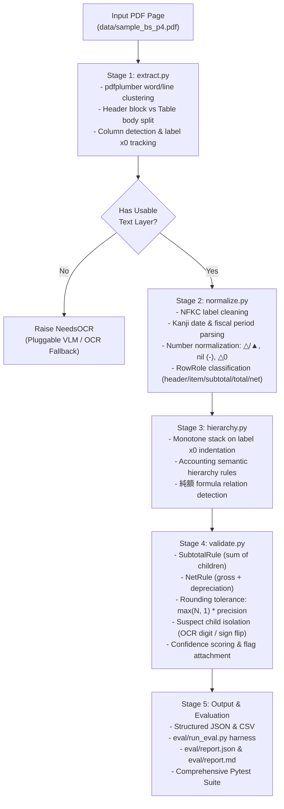

# Japanese Financial Statement PDF Parser (jp-fin-parser)

A tested prototype parser that converts born-digital pages of Japanese public-company financial filings (such as the **連結貸借対照表** consolidated balance sheet) into validated, structured tables (JSON and CSV) complete with hierarchical accounting trees, formula relations, and arithmetic verification.

---

## 1. Problem Framing

Japanese corporate financial filings (EDINET / TDnet disclosures) present unique challenges for automated table extraction:

1. **Lost Spatial & Table Structure:** While filings are often born-digital (retaining raw character glyphs), reading order, table bounds, and indentation hierarchies are absent from the underlying PDF stream.
2. **Context Outside the Table:** Critical parsing context resides in detached header lines above the table:
   - Reporting unit scale: `（単位：千円）` (thousand yen) or `（単位：百万円）` (million yen).
   - Comparative period labels and dates: `前連結会計年度 (2025年3月31日)` and `当連結会計年度 (2026年3月31日)`.
   - Filing status markers: `（訂正後）` (post-correction revision).
3. **Japanese Accounting Conventions:**
   - Negative amounts are represented with Japanese financial symbols: `△` or `▲` or parentheses `()`.
   - Explicit nil/dash values (`－`, `―`, `-`) represent defined zero/empty lines and must be strictly distinguished from missing data (`null`).
   - Mixed character encodings: Full-width digits (`１２３`), full-width brackets (`（`, `）`), and Japanese spacing require normalization without destroying character meaning.
4. **Non-Trivial Formulas:** Tangible fixed assets follow gross-minus-depreciation patterns:
   $$\text{建物及び構築物（純額）} = \text{建物及び構築物 (gross)} + \text{減価償却累計額 (negative)}$$
   These are formula relations, not plain additive subtotals.
5. **Separately Rounded Discrepancies:** Corporate disclosures round line items to the nearest thousand yen before printing. As a result, the sum of printed child items frequently differs from the printed subtotal by a few units (e.g. current-period `流動資産` items sum to 3,377,405 vs printed 3,377,407). A naive sum check would incorrectly fail valid filings.

---

## 2. Definition of "Correct"

This system measures correctness through three complementary, objective metrics:

| Metric | Target | Rationale & Definition |
| :--- | :---: | :--- |
| **1. Cell Accuracy** | **100.0%** | **Exact match of `(label, prior, current)` triples against human-verified ground truth.**<br>Downstream valuation models, quant pipelines, and credit scoring systems cannot tolerate a single corrupted digit, shifted column, or flipped sign. |
| **2. Structural Accuracy** | **100.0%** | **Exact match of row order, indentation depth (`level`), semantic role (`row_type`), and `parent_index`.**<br>Extracting flat cells is insufficient; financial data requires parent-child tree relationships to enable dynamic rollups and XBRL mapping. |
| **3. Arithmetic Consistency** | **100.0%** | **Fraction of subtotal, total, and net rows whose values reconcile mathematically within rounding tolerance.**<br>Unlike cell and structure accuracy, arithmetic consistency requires **zero ground-truth labels**. It can run on unlabeled documents and serves as an unsupervised confidence score. |

---

## 3. Architecture Overview

The pipeline employs a clean 5-stage architecture where each stage is independently testable, strictly typed with Pydantic, and adheres to the principle of **never silently guessing**.



---

## 4. Evaluation Results on Sample Filing

These results are on the single development page the parser was built against; they show the pipeline is correct on it, not that it generalizes.

Ground truth for the sample page was drafted by an LLM directly from the page (independently of the parser), then verified by me through full arithmetic reconciliation, a value-by-value comparison against the PDF, and a visual check of the rendered page. Hierarchy levels and formula_of links were assigned by me following a fixed scheme.

Evaluated against the human-verified ground truth ([`eval/ground_truth/sample_bs_p4.json`](eval/ground_truth/sample_bs_p4.json)):

### Metric Scorecard

| Metric | Result | Passing / Total | Status |
| :--- | :---: | :---: | :---: |
| **Cell Accuracy** | **100.00%** | 86 / 86 period cells | **PASSED** |
| **Structural Accuracy** | **100.00%** | 43 / 43 rows | **PASSED** |
| **Formula Dependency Accuracy** | **100.00%** | 10 / 10 `formula_of` lists | **PASSED** |
| **Arithmetic Consistency** | **100.00%** | 20 / 20 checks | **PASSED** |

*Note on arithmetic consistency:* Counts 5 subtotals + 4 net rows + 1 total, times 2 periods = 20 checks for the sample page. 

### 10-Category Error Taxonomy

Every potential parsing mismatch is tracked and categorized:

| Category | Count | Status | Description |
| :--- | :---: | :---: | :--- |
| `wrong_number` | 0 | **PASSED** | Extracted number differs from true value |
| `wrong_sign` | 0 | **PASSED** | Sign inverted between positive and negative |
| `nil_vs_zero` | 0 | **PASSED** | Explicit nil (`－`) confused with numeric zero |
| `missing_row` | 0 | **PASSED** | Expected filing row omitted |
| `extra_row` | 0 | **PASSED** | Stray text row included |
| `merged_rows` | 0 | **PASSED** | Multiple line items collapsed into one |
| `wrong_level` | 0 | **PASSED** | Indentation hierarchy depth incorrect |
| `wrong_row_type` | 0 | **PASSED** | Semantic role mismatch (item, header, subtotal, etc.) |
| `wrong_parent` | 0 | **PASSED** | Parent node index misaligned |
| `wrong_unit` | 0 | **PASSED** | Multiplier / scale factor misapplied (1,000x / 1,000,000x) |

### Rounding Gaps Verification

Corporate filings round individual line items, causing small summation deltas. The validator uses a principled tolerance:
$$\text{tolerance} = \max(N_{\text{children}}, 1) \times \text{unit\_precision}$$

There are **13 non-zero rounding gaps** ($\Delta > 0$) across the two reporting periods. All 13 pass validation:

| Row | Period | Expected | Printed | Difference | Tolerance | Status |
| :--- | :---: | :---: | :---: | :---: | :---: | :---: |
| 流動資産合計 | 前連結会計年度 | 5,863,681 | 5,863,684 | 3 | 10 | **PASS** |
| 流動資産合計 | 当連結会計年度 | 3,377,405 | 3,377,407 | 2 | 10 | **PASS** |
| 有形固定資産合計 | 前連結会計年度 | 1,429,093 | 1,429,094 | 1 | 5 | **PASS** |
| 有形固定資産合計 | 当連結会計年度 | 1,352,607 | 1,352,610 | 3 | 6 | **PASS** |
| 無形固定資産合計 | 前連結会計年度 | 44,260 | 44,261 | 1 | 2 | **PASS** |
| 無形固定資産合計 | 当連結会計年度 | 35,868 | 35,869 | 1 | 2 | **PASS** |
| 投資その他の資産合計 | 前連結会計年度 | 197,068 | 197,069 | 1 | 4 | **PASS** |
| 投資その他の資産合計 | 当連結会計年度 | 369,361 | 369,362 | 1 | 5 | **PASS** |
| 固定資産合計 | 前連結会計年度 | 1,670,424 | 1,670,426 | 2 | 3 | **PASS** |
| 資産合計 | 当連結会計年度 | 5,135,248 | 5,135,249 | 1 | 2 | **PASS** |
| 建物及び構築物（純額） | 当連結会計年度 | 239,829 | 239,828 | 1 | 2 | **PASS** |
| リース資産（純額） | 前連結会計年度 | 63,147 | 63,146 | 1 | 2 | **PASS** |
| リース資産（純額） | 当連結会計年度 | 41,873 | 41,872 | 1 | 2 | **PASS** |

### Fuzz Testing & Perturbation Detection

[`tests/test_fuzz.py`](tests/test_fuzz.py) systematically perturbs extracted cells one at a time and re-runs normalization, hierarchy, and validation:

| Perturbation Type | Tested ($>\text{tol}$) | Detected | Detection Rate | Sub-Tolerance ($\le\text{tol}$) Exempted |
| :--- | :---: | :---: | :---: | :---: |
| **Drop Minus Sign** (`△2,979` $\to$ `2,979`) | 9 | 9 | **100.0%** | 1 (`△0` $\to$ `0`) |
| **Swap Adjacent Digits** (`429` $\to$ `492`) | 71 | 71 | **100.0%** | 0 |
| **Shift Value by 1000** ($+1000$) | 72 | 72 | **100.0%** | 0 |
| **Swap Prior & Current Columns** | 34 | 34 | **100.0%** | 1 (identical values) |

**Not yet done: evaluation on unseen pages.** The parser has only been run against the single development page above. A held-out test (for example the liabilities page of the same filing, which would also exercise the balance-sheet identity on real data) is the first item in "What I'd Do Next".

---

## 5. Label-Free Confidence Signals & Human Review Prioritization

In real-world ingestion, ground truth does not exist for newly filed PDFs. This system uses rule-based validation to produce an unsupervised confidence score:

1. **Self-Auditing Verification:**
   - Every subtotal row verifies $\text{subtotal} = \sum \text{children}$.
   - Every net row verifies $\text{net} = \text{gross} + \text{accumulated depreciation}$.
   - Balance Sheet Identity ($\text{資産合計} = \text{負債純資産合計}$) is implemented and unit-tested in `tests/unit/validation/test_validate.py`; on single-page data containing only the assets side, it is gracefully skipped.
2. **Confidence Adjustment & Flagging:**
   - A clean, reconciling row receives a confidence score of `1.0`.
   - When arithmetic fails, the subtotal is penalized by `0.30` and flagged with `ValidationFlag.ARITHMETIC_MISMATCH`.
3. **Single-Suspect Child Isolation:**
   When discrepancy $\Delta = \text{actual} - \text{expected}$ occurs:
   - The engine tests whether a single child's sign flip ($c_{\text{val}} + \Delta == -c_{\text{val}}$) or single-digit OCR typo (Levenshtein distance of 1 between candidate and current) resolves the difference.
   - If isolated, it emits a non-destructive `CorrectionSuggestion` (e.g. *"Suspect dropped negative sign: current 2979 vs suggested -2979"*) without mutating the extracted data.
4. **Prioritizing Human Audit:**
   Instead of randomly sampling filings, operations teams filter by `report.arithmetic_pass_rate < 1.0` or low row confidence scores, reviewing only flagged anomalies.

---

## 6. Honest Limitations & Known Failure Modes

1. **Scanned & Image-Only PDFs:** The primary extractor relies on native text bounding boxes (`pdfplumber`). For scanned filings without a digital text layer, the system raises a clear `NeedsOCR` signal rather than silently returning empty output.
2. **Unconventional Layouts:** The clustering algorithm assumes a standard financial filing layout (left-aligned labels with right-aligned numeric columns). It does not currently handle:
   - Side-by-side statements (e.g. assets on the left half and liabilities on the right half of a single page).
   - Ruled tables with dense physical border grids.
   - Irregular line items with merged header spans across 4+ columns.
3. **Statement Scope:** The current implementation specializes in consolidated balance sheets (`連結貸借対照表`). Consolidated statements of income (`損益計算書`), cash flows (`キャッシュ・フロー計算書`), and footnote schedules follow different accounting arithmetic, section flows, and sign conventions.
4. **Non-Standard Subtotal Phrasing:** While common patterns (`合計`, `計`, `部合計`, `純額`) are recognized, unusual proprietary phrasing in non-EDINET disclosures may require dictionary additions.
5. **Tolerance Blind Spot:** Errors smaller than the rounding tolerance are undetectable by arithmetic checks alone; the fuzz test exempts exactly this range.

---

## 7. What I'd Do Next (With More Time and More PDFs)

1. **Held-out Evaluation on Additional Pages and Companies:**
   - Run the parser on pages it was not developed against, starting with the liabilities and net assets page of the same filing (exercises the balance-sheet identity on real data), then balance sheets from other companies.
   - Report cell, structural, and arithmetic metrics separately for these pages so generalization is measured rather than assumed.
2. **Multi-Statement Rule Packs:**
   - Expand `validate.py` with rules for Income Statements (Gross Profit = Revenue - Cost of Sales; Operating Profit = Gross Profit - SG&A; Net Income reconciliation).
   - Cash Flow rules (operating, investing, financing subtotal rollups and cash balance reconciliation).
3. **Multi-Page Table Stitching:**
   - Implement continuous table linking across page breaks, matching continuation tokens and recurring column headers across pages 4, 5, and 6.
4. **Layout Strategy Router:**
   - Build a layout classifier that inspects page geometry and switches strategies:
     - `RuledTableStrategy`: uses horizontal/vertical vector lines for bordered tables.
     - `SideBySideStrategy`: splits page at central gutter for simultaneous asset/liability pages.
     - `VLMStrategy`: fallback for scanned pages using a lightweight multimodal model with strict bounding-box JSON constraints.
5. **EDINET Taxonomy Linking:**
   - Map normalized Japanese account labels to standardized EDINET taxonomy elements (`jppfs_cor:CashAndDeposits`, `jppfs_cor:NotesAndAccountsReceivableTrade`).

---

## 8. Running the Project

### Environment Setup

```bash
# Clone and enter directory
cd jp-fin-parser

# Create virtual environment
python3 -m venv .venv
source .venv/bin/activate

# Install dependencies
pip install pytest pydantic pdfplumber pymupdf rich
```

### Running Tests

```bash
# Run entire test suite (241 tests)
pytest

# Run evaluation tests
pytest tests/test_eval.py

# Run fuzz perturbation tests
pytest tests/test_fuzz.py -s
```

### Running Evaluation Harness

```bash
# Run evaluation across data/ directory
python eval/run_eval.py
```
Outputs:
- Formatted summary report printed to stdout.
- Detailed machine-readable JSON: [`eval/report.json`](eval/report.json).
- Formatted Markdown report: [`eval/report.md`](eval/report.md).
